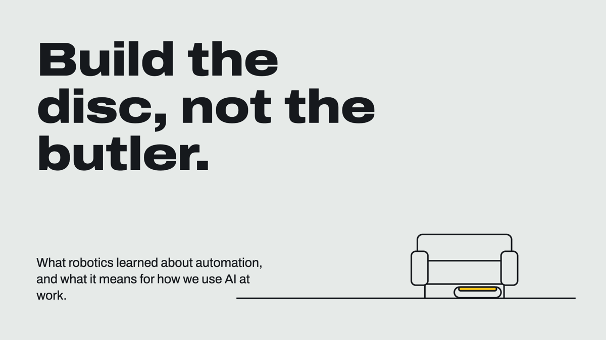
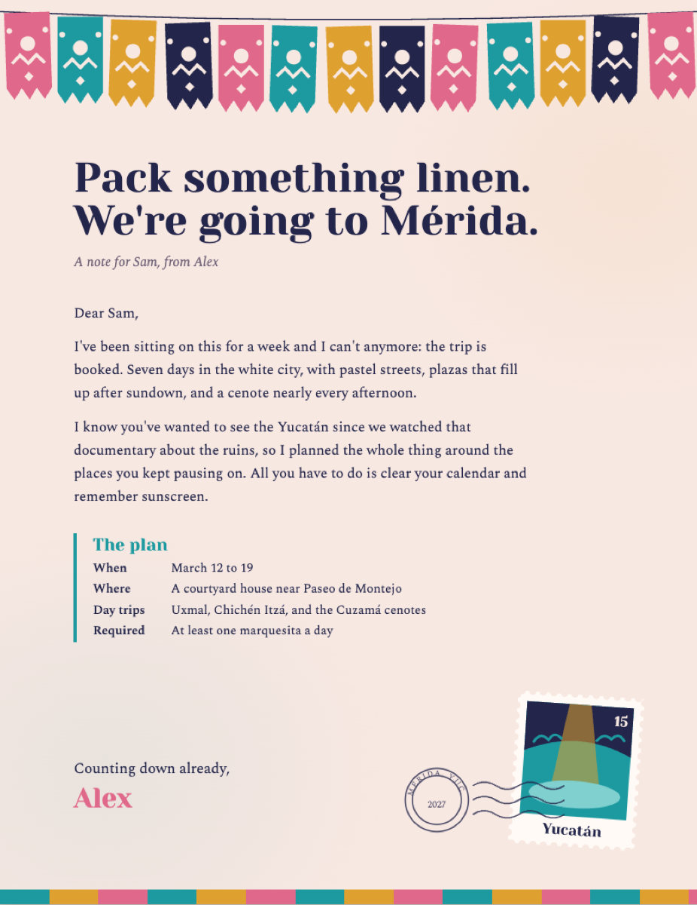
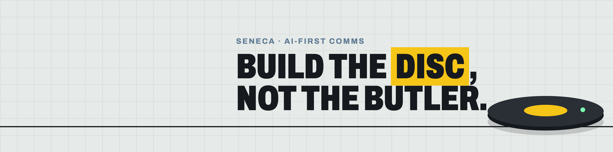
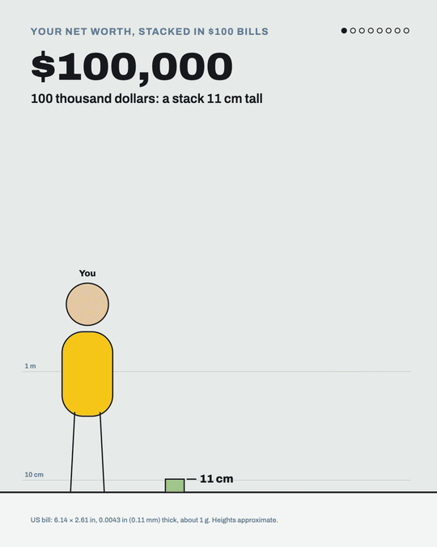
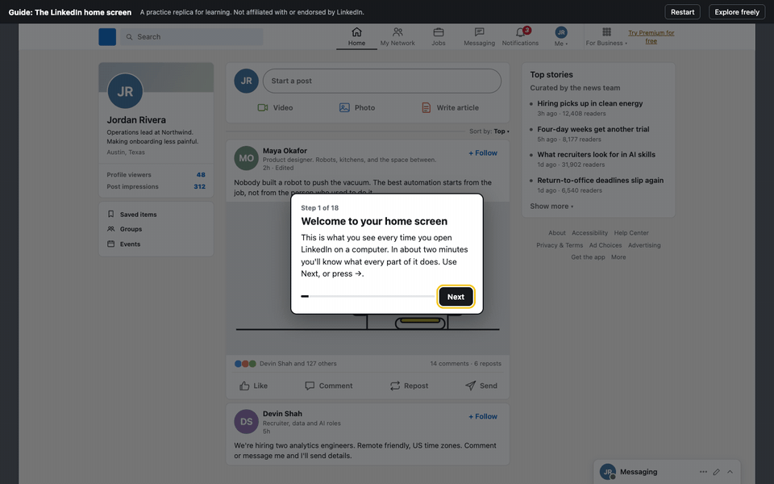
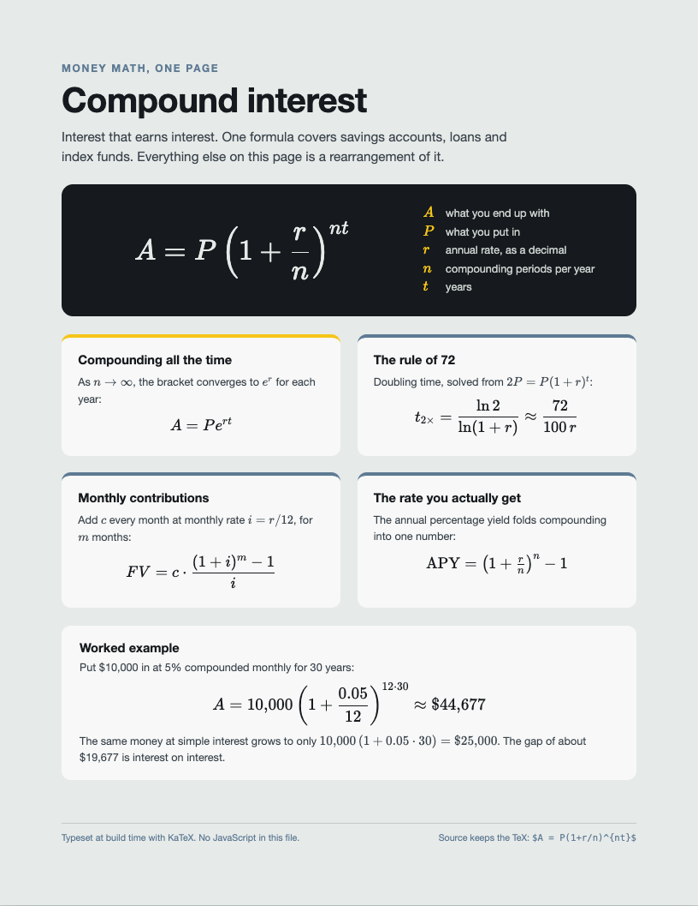

# Build the disc, not the butler


Robotics spent fifty years learning that you shouldn't automate a job by copying how a human does it. Dishwashers don't scrub one plate at a time. Washing machines don't use washboards. Robot vacuums aren't humanoids pushing an upright vacuum. The machines that won were designed around the job, not around the person who used to do it.

AI at work is still building butlers. We ask it to drive PowerPoint and Word, tools designed for a human with a mouse, when it's already fluent in the thing browsers render best: **HTML, CSS, and JavaScript.**

This repo has six [Claude Code](https://claude.com/claude-code) skills that build communication artifacts the way AI works best, plus a front door, `/seneca`, that picks which ones fit your audience and builds them together:

| Skill | What it makes | Output |
|---|---|---|
| **ai-slide-deck** | Presentations with transitions, builds, speaker notes, and an overview grid | One `.html` file + a one-slide-per-page `.pdf` |
| **ai-pdf** | Letters, invitations, itineraries, and one-pagers on custom-designed stationery | Print-accurate `.pdf` |
| **ai-gif** | Looping motion graphics for explainers, social posts, and visual gags | `.gif` + optional `.mp4` |
| **ai-interactive-guide** | Click-through software walkthroughs: a rebuilt replica of the app with a spotlight and step-by-step coach marks | One `.html` file + optional walkthrough `.gif` |
| **ai-scale** | Big numbers you can feel: money stacked next to a person and zooming out to space, amounts walked back through history, exponential growth | `.mp4`/`.gif`, an interactive `.html` explorer, and a `.png` per stop |
| **ai-graphic** | Static graphics at any size: profile banners, social posts, link-preview images, thumbnails, avatars, stickers | `.png` (or `.jpg`) per artboard, with platform safe-zone checks |
| **ai-math** | Math as code: Manim animations, KaTeX equations inside any of the formats above, and real LaTeX documents | `.mp4` / `.gif` / transparent clip, typeset `.html`, LaTeX `.pdf` |
| **ai-video-edit** | Edits a selfie or talking-head recording by what's said: name tags, stat callouts, price quotes, CTAs, captions, and end cards, timed to the speaker's words (transcribed locally with Whisper) | Edited `.mp4` + an `edit.json` you can tweak and re-render |

Each skill pairs with Anthropic's `frontend-design` skill for the design pass, and gives Claude a reference sheet of the parameters a professional would think about: form factors, safe areas, type scales, paper sizes, loop timing, file-size budgets.

## Examples

Every file in [`examples/`](examples) was made with these skills, from a single HTML source each.

| Slide deck | Stationery PDF |
|---|---|
| [](examples/deck/build-the-disc.html) | [](examples/pdf/merida-letter.pdf) |
| [HTML deck](examples/deck/build-the-disc.html) · [PDF](examples/deck/build-the-disc.pdf) | [PDF](examples/pdf/merida-letter.pdf) · [source](examples/pdf/merida-letter.html) |

The GIF at the top is [`examples/gif/any-format.html`](examples/gif/any-format.html), rendered by `ai-gif`. There's also [`disc-not-butler.gif`](examples/gif/disc-not-butler.gif): a humanoid robot pushing a vacuum keeps bonking into a couch while a robot-vacuum disc glides underneath it.

**Graphics:** [`seneca-graphics.html`](examples/graphic/seneca-graphics.html) is one file with three artboards: a [LinkedIn banner](examples/graphic/seneca-linkedin-banner.png), a [link-preview image](examples/graphic/seneca-og.png), and a [transparent sticker](examples/graphic/seneca-sticker.png).



**Scale:** [`money-tower`](examples/scale/money-tower.html) stacks net worth in $100 bills from $100K to $1T, which passes the Space Station. [`money-time`](examples/scale/money-time.html) spends $1 a second backwards to the Ice Age, then the dinosaurs. [`paper-moon`](examples/scale/paper-moon.html) folds paper 42 times to reach the Moon. Each one is a single scene file rendered three ways.



**Interactive guide:** [a tour of the LinkedIn home screen](examples/guide/linkedin-home-tour.html). Open it in a browser and it tells you what each part does and what to click, and reacts when you click it. It's a practice replica rebuilt from scratch and isn't affiliated with LinkedIn.



**Math:** three routes to one topic in [`examples/math/`](examples/math):

- [`pythagoras.py`](examples/math/pythagoras.py) is a Manim scene, rendered to [MP4](examples/math/pythagoras.mp4) and the GIF below.
- [`compound-interest.src.html`](examples/math/compound-interest.src.html) is a one-pager with LaTeX math, typeset by KaTeX into [HTML](examples/math/compound-interest.html) and printed to [PDF](examples/math/compound-interest.pdf).
- [`continuous-compounding.tex`](examples/math/continuous-compounding.tex) is a derivation compiled to [PDF](examples/math/continuous-compounding.pdf) with Tectonic.

| Manim animation | KaTeX one-pager |
|---|---|
|  | [](examples/math/compound-interest.pdf) |

## Install

**As a Claude Code plugin** (recommended):

```
/plugin marketplace add https://github.com/htank898/Seneca.git
/plugin install seneca@seneca
```

Plugin skills are namespaced, so the front door is `/seneca:seneca` and each format is `/seneca:ai-slide-deck`, `/seneca:ai-gif`, and so on. To type just `/seneca`, also add the one-file shortcut:

```bash
git clone https://github.com/htank898/Seneca.git
cp -r Seneca/shortcut/seneca ~/.claude/skills/
```

**Or copy the skills** into your personal skills folder instead of installing the plugin. Then `/seneca` works directly, with no shortcut needed:

```bash
git clone https://github.com/htank898/Seneca.git
cp -r Seneca/skills/* ~/.claude/skills/
```

**Requirements:** Node 18+ and `ffmpeg` (for GIFs; on macOS run `brew install ffmpeg`). Each skill installs its own copy of Playwright the first time it renders. If a Chromium download is needed, that happens once too.

`ai-math` has two optional extras:

- **Manim animations need [`uv`](https://docs.astral.sh/uv/).** The first render builds a private Python environment inside the skill. If `pycairo` won't build, run `brew install cairo pkgconf`.
- **LaTeX PDFs need Tectonic** (`brew install tectonic`).

KaTeX typesetting needs nothing beyond Node.

`ai-video-edit` also needs [`uv`](https://docs.astral.sh/uv/). The first transcription builds a private Python environment with faster-whisper and downloads the Whisper model once (about 1.6 GB). Recordings never leave your machine.

## Usage

**Describe the situation and let Seneca choose.** Seneca writes the core message once, picks the smallest set of formats where each one has a job, and builds them in a shared visual style:

- *"/seneca I have a budget review with the CFO and two VPs on Thursday. Here are the numbers. Summarize them for these stakeholders."* This gives you a 6-slide deck with the answer first, a one-page PDF pre-read to send the day before, and a stat card for the team channel afterwards.
- *"/seneca We're rolling out the new CRM to 40 reps next week."* This gives you an interactive guide, a walkthrough GIF, and a one-page PDF cheat sheet.

**Or name the format** and that skill runs directly:

- *"Make a 6-slide status update deck on the Q3 migration. It's for execs, so put the answer first."*
- *"Write a letter to my team announcing the offsite, on stationery that feels like a vintage national-park poster."*
- *"Make a 4-second looping GIF of a progress bar that gets to 99% and then starts over, for a Slack joke."*
- *"Build an interactive guide that walks new reps through converting a lead in our CRM."*
- *"How big is a trillion dollars? Make a short video for LinkedIn."*
- *"Make me a LinkedIn banner that says I build AI automation for freight, plus a matching square post."*
- *"Animate why the sum of the first n integers is n(n+1)/2, as a square video for LinkedIn."*
- *"Add the Black-Scholes formula to slide 4 of the deck."*
- *"Write up the derivation as a two-page LaTeX PDF."*
- *"Here's a selfie video walking Northwind through their quote. Add my name, the price breakdown, and a book-a-call button."*

Claude picks the skill, does a design pass, builds the HTML, renders it, checks its own output, and hands you the files.

You can also run the renderers yourself on any HTML that follows the templates' contracts:

```bash
node skills/ai-slide-deck/scripts/render-deck-pdf.mjs deck.html --png
node skills/ai-pdf/scripts/render-pdf.mjs letter.html --preview
node skills/ai-gif/scripts/render-gif.mjs motion.html --mp4
node skills/ai-graphic/scripts/render-png.mjs graphic.html --scale 2 --guides
node skills/ai-scale/scripts/scale.mjs preset money-tower --out scene.json && node skills/ai-scale/scripts/build.mjs scene.json
node skills/ai-interactive-guide/scripts/render-steps.mjs guide.html --gif
node skills/ai-interactive-guide/scripts/capture-ui-map.mjs https://app.example.com --headed --profile ./.guide-profile --wait
node skills/ai-math/scripts/render-math.mjs scene.py SceneName --size 1080x1080 --gif
node skills/ai-math/scripts/typeset.mjs page.src.html --out page.html
node skills/ai-math/scripts/latex-pdf.mjs paper.tex --preview
python3 skills/ai-video-edit/scripts/transcribe.py pitch.mov
node skills/ai-video-edit/scripts/cues.mjs pitch.transcript.json
node skills/ai-video-edit/scripts/render-edit.mjs edit.json --preview 3,9.5
```

## How it works

- **Decks:** a small engine in a single HTML file handles navigation, transitions, builds, notes, and print. Chromium prints it to PDF at the deck's exact size.
- **PDFs:** pages are laid out at real paper dimensions with CSS `@page`. Stationery art is a background layer of SVG and CSS, and Chromium's print engine writes the PDF.
- **Guides:** the replica is ordinary HTML/CSS. A small engine spotlights the element each step points at, positions the coach card, and only advances click steps when the learner clicks the right thing. An optional capture script records a real app's layout (positions and labels, not its code) so the replica is accurate.
- **Graphics:** each artboard is a fixed-pixel box with platform presets and crop/overlay guides. Playwright screenshots each one at 1× or 2× to PNG, with transparency if asked.
- **Scale:** a calculator turns a number into a scene file: real units, landmarks, dates, and auto-written "taller than X, short of Y" captions. One prewritten engine animates any scene with a camera that zooms in powers of ten. It works as an MP4, a GIF, an interactive page, or slide stills.
- **GIFs:** the animation is a pure function `renderFrame(t)`. Playwright steps through every frame and screenshots it, then ffmpeg builds an optimized palette and encodes a seamless loop.
- **Math:** Manim scenes, with Typst for equations, render to MP4 and GIF. With `--clip` they become a transparent frame sequence that any `renderFrame(t)` page can draw, so math animations drop into GIFs, videos, and guides. KaTeX typesets LaTeX into the HTML at build time, so pages carry no math JavaScript, only the fonts they use. Tectonic compiles real LaTeX with no TeX Live install.
- **Video edits:** faster-whisper transcribes the recording on your machine with a timestamp for every word. Claude reads the transcript like an editor and writes `edit.json`, a list of overlays keyed to phrases ("when I say 'your quote'…"). A `renderFrame(t)` page draws the overlays as transparent frames, and ffmpeg lays them over the footage. It can also freeze the frame for a few seconds when a price needs reading time.

## License

MIT. Third-party tools the skills install are listed, with their licenses, in [`THIRD_PARTY_NOTICES.md`](THIRD_PARTY_NOTICES.md).
