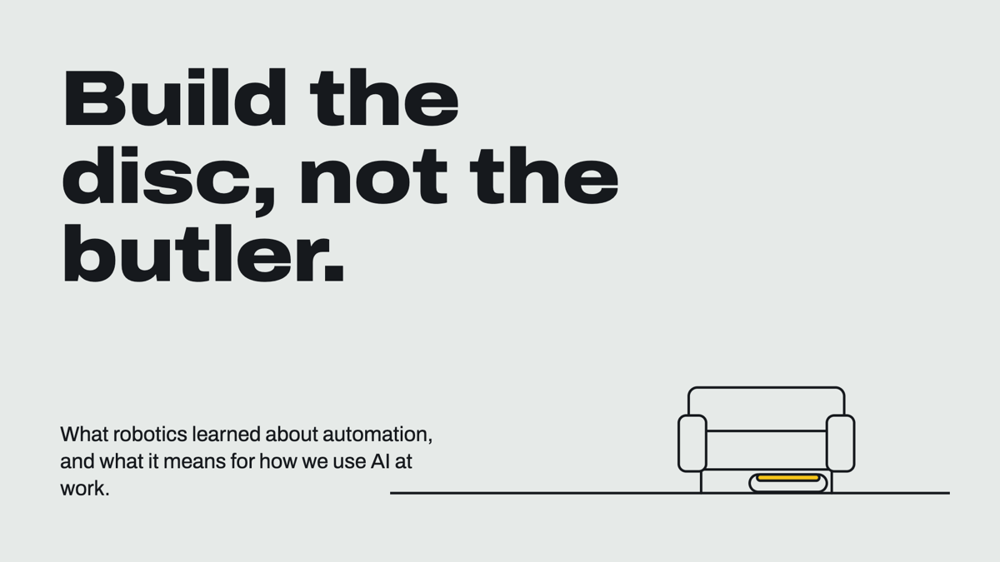
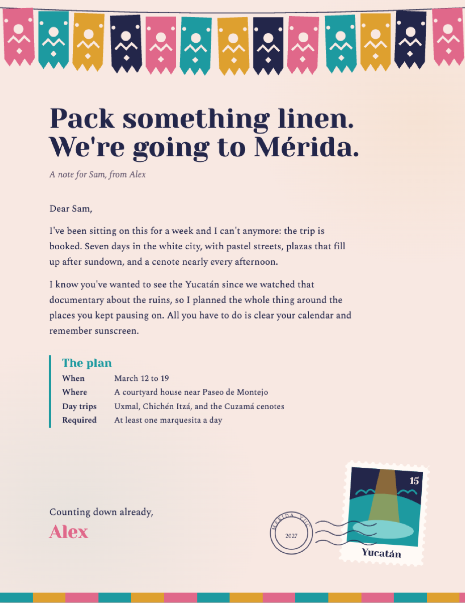
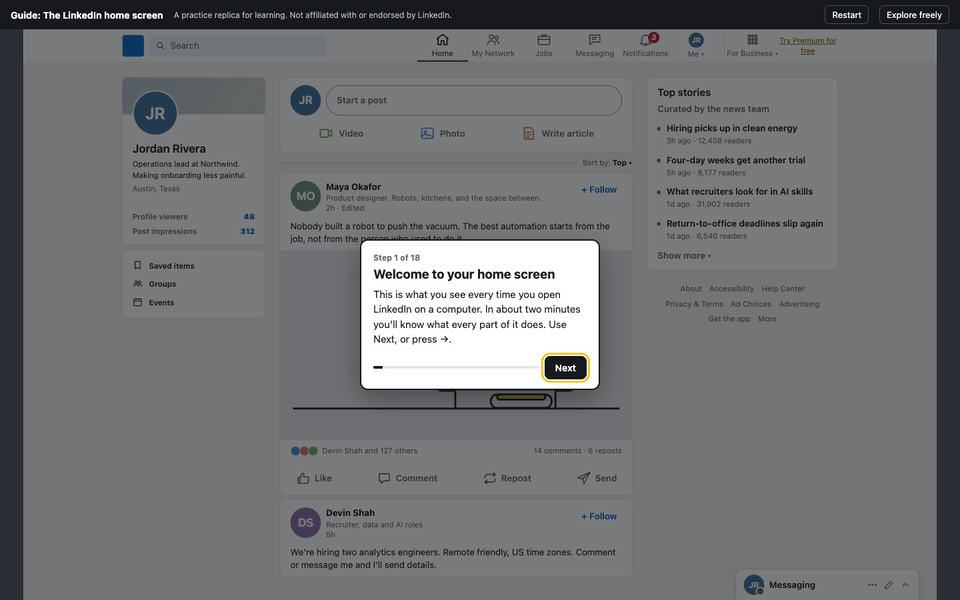

# Build the disc, not the butler


Robotics spent fifty years learning that you shouldn't automate a job by copying how a human does it. Dishwashers don't scrub one plate at a time. Washing machines don't use washboards. Robot vacuums aren't humanoids pushing an upright vacuum. The machines that won were designed around the job, not around the person who used to do it.

AI at work is still building butlers. We ask it to drive PowerPoint and Word, tools designed for a human with a mouse, when it's already fluent in the thing browsers render best: **HTML, CSS, and JavaScript.**

This repo has four [Claude Code](https://claude.com/claude-code) skills that build communication artifacts the way AI works best:

| Skill | What it makes | Output |
|---|---|---|
| **ai-slide-deck** | Presentations with transitions, builds, speaker notes, and an overview grid | One `.html` file + a one-slide-per-page `.pdf` |
| **ai-pdf** | Letters, invitations, itineraries, and one-pagers on custom-designed stationery | Print-accurate `.pdf` |
| **ai-gif** | Looping motion graphics for explainers, social posts, and visual gags | `.gif` + optional `.mp4` |
| **ai-interactive-guide** | Click-through software walkthroughs: a rebuilt replica of the app with a spotlight and step-by-step coach marks | One `.html` file + optional walkthrough `.gif` |

Each skill pairs with Anthropic's `frontend-design` skill for the design pass, and gives Claude a reference sheet of the parameters a professional would think about: form factors, safe areas, type scales, paper sizes, loop timing, file-size budgets.

## Examples

Every file in [`examples/`](examples) was made with these skills, from a single HTML source each.

| Slide deck | Stationery PDF |
|---|---|
| [](examples/deck/build-the-disc.html) | [](examples/pdf/merida-letter.pdf) |
| [HTML deck](examples/deck/build-the-disc.html) · [PDF](examples/deck/build-the-disc.pdf) | [PDF](examples/pdf/merida-letter.pdf) · [source](examples/pdf/merida-letter.html) |

The GIF at the top is [`examples/gif/any-format.html`](examples/gif/any-format.html), rendered by `ai-gif`. There's also [`disc-not-butler.gif`](examples/gif/disc-not-butler.gif): a humanoid robot pushing a vacuum keeps bonking into a couch while a robot-vacuum disc glides underneath it.

**Interactive guide:** [a tour of the LinkedIn home screen](examples/guide/linkedin-home-tour.html). Open it in a browser and it tells you what each part does and what to click, and reacts when you click it. It's a practice replica rebuilt from scratch and isn't affiliated with LinkedIn.



## Install

**As a Claude Code plugin** (recommended):

```
/plugin marketplace add https://github.com/htank898/Seneca.git
/plugin install ai-first-comms@ai-first-comms
```

**Or copy the skills** into your personal skills folder:

```bash
git clone https://github.com/htank898/Seneca.git
cp -r Seneca/skills/* ~/.claude/skills/
```

**Requirements:** Node 18+ and `ffmpeg` (for GIFs; on macOS run `brew install ffmpeg`). Each skill installs its own copy of Playwright the first time it renders. If a Chromium download is needed, that happens once too.

## Usage

Just ask:

- *"Make a 6-slide status update deck on the Q3 migration. It's for execs, so put the answer first."*
- *"Write a letter to my team announcing the offsite, on stationery that feels like a vintage national-park poster."*
- *"Make a 4-second looping GIF of a progress bar that gets to 99% and then starts over, for a Slack joke."*
- *"Build an interactive guide that walks new reps through converting a lead in our CRM."*

Claude picks the skill, does a design pass, builds the HTML, renders it, checks its own output, and hands you the files.

You can also run the renderers yourself on any HTML that follows the templates' contracts:

```bash
node skills/ai-slide-deck/scripts/render-deck-pdf.mjs deck.html --png
node skills/ai-pdf/scripts/render-pdf.mjs letter.html --preview
node skills/ai-gif/scripts/render-gif.mjs motion.html --mp4
node skills/ai-interactive-guide/scripts/render-steps.mjs guide.html --gif
node skills/ai-interactive-guide/scripts/capture-ui-map.mjs https://app.example.com --headed --profile ./.guide-profile --wait
```

## How it works

- **Decks:** a small engine in a single HTML file handles navigation, transitions, builds, notes, and print. Chromium prints it to PDF at the deck's exact size.
- **PDFs:** pages are laid out at real paper dimensions with CSS `@page`. Stationery art is a background layer of SVG and CSS, and Chromium's print engine writes the PDF.
- **Guides:** the replica is ordinary HTML/CSS. A small engine spotlights the element each step points at, positions the coach card, and only advances click steps when the learner clicks the right thing. An optional capture script records a real app's layout (positions and labels, not its code) so the replica is accurate.
- **GIFs:** the animation is a pure function `renderFrame(t)`. Playwright steps through every frame and screenshots it, then ffmpeg builds an optimized palette and encodes a seamless loop.

## License

MIT
